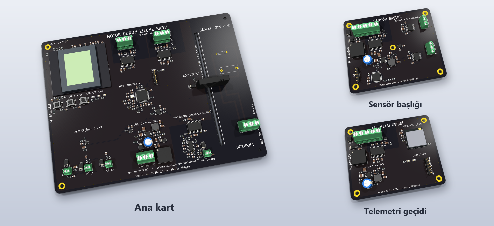
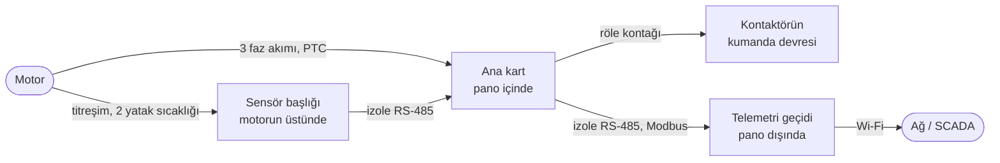
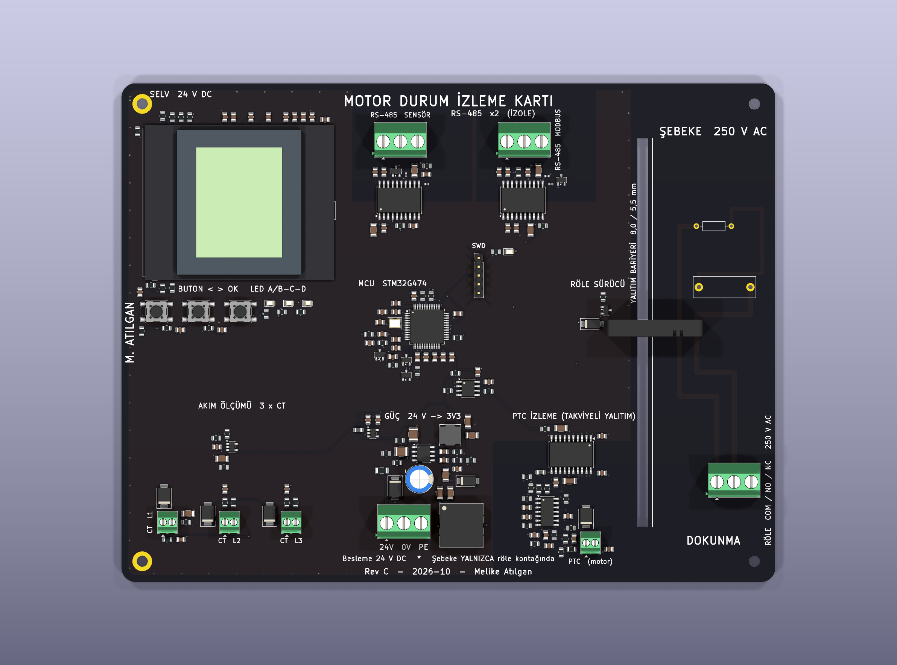
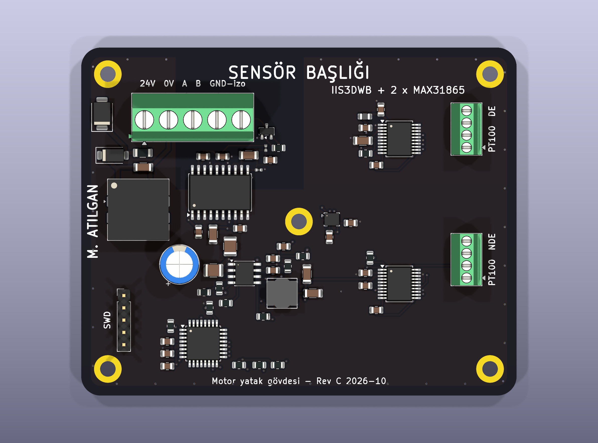
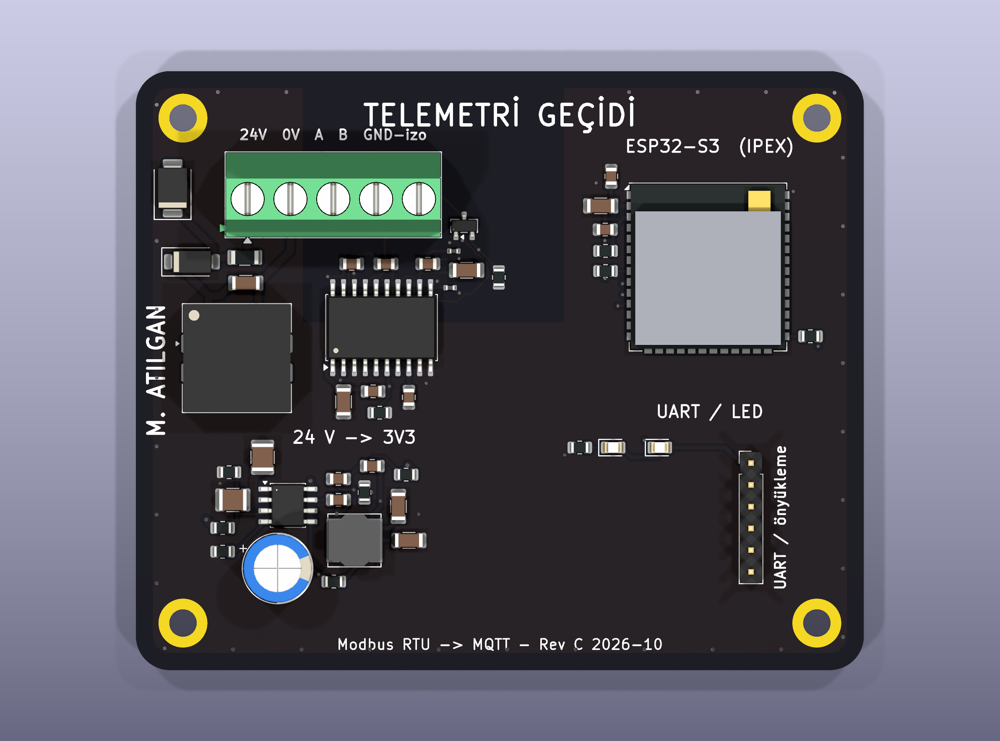

# İzleme kartları (KiCad)

Arıza analizinde titreşim ve yatak sıcaklığı için otomatik bir koruma olmadığı
çıktı; bunlar ancak aylık kontrolde fark ediliyordu. Motoru sürekli izlemek için
üç kart tasarladım: motorun üstünde ölçen bir sensör başlığı, panoda karar veren
bir ana kart ve ölçümleri ağa aktaran bir telemetri geçidi.

  

## Nasıl birlikte çalışıyorlar

Ana kart diğer ikisi olmadan da çalışır: akımı ve PTC'yi kendisi ölçer, röleyi
kendisi açar. Sensör başlığı titreşim ve yatak sıcaklığını ekler, geçit yalnızca
izleme içindir.

**Ana koruma değil.** Kartın röle kontağı, sertifikalı termik röle ve PTC
rölesiyle birlikte kumanda devresine seri girer. Kart arızalansa da onlar
görevini yapar. Röle normalde çekili; kartın beslemesi kesilirse kontak açılır
ve motor durur.

Aşağıda her kartın tasarlandığı işi yazdım; bu işleri yürütecek firmware bu
depoda yok.

## Ana kart

  

Elektrik panosunun içine takılır, 24 V DC ile beslenir.

- Üç faz akımını akım trafolarıyla ölçer.
- Motor sargısındaki PTC sıcaklık sensörlerini izole bir girişle okur; kısa
  devre, normal, attı ve kopuk durumlarını ayırır.
- Sensör başlığından titreşim ve yatak sıcaklıklarını alır.
- Bir sınır aşılırsa röle kontağını açar. Kontak kontaktörün kumanda devresine
  seri bağlı; açılınca kontaktör bobini enerjisiz kalır ve kontaktör motorun
  beslemesini keser.
- Durumu LCD'de ve titreşim bölgesini gösteren LED'lerde (yeşil A/B, sarı C,
  kırmızı D) gösterir; üç buton (<, >, OK) var.
- Ölçümleri izole RS-485 üzerinden Modbus ile geçide verir.

**Üzerinde:** STM32G474 · ISOW7744 (PTC izolatörü) · 2 × ADM2582E (izole
RS-485) · LM5164 (24 V → 3,3 V) · LM339B · Finder 34.51 röle · EA DOGM128 LCD.
190 × 145 mm, 4 katman.

**Dosyalar:** [KiCad projesi](ana-kart/) ·
[şematik (PDF)](uretim/ana-kart/motor-izleme-karti-sematik.pdf) ·
[kart katmanları (PDF)](uretim/ana-kart/motor-izleme-karti-kart.pdf) ·
[Gerber](uretim/ana-kart/motor-izleme-karti-gerber.zip) ·
[malzeme listesi](uretim/ana-kart/motor-izleme-karti-bom.csv) ·
[STEP](uretim/ana-kart/motor-izleme-karti.step)

## Sensör başlığı

  

Motorun yatak gövdesine vidalanır. Besleme ve haberleşme aynı kablodan gelir
(24 V, 0 V, RS-485 A/B, izole toprak).

- Titreşimi IIS3DWB ivmeölçerle ölçer; geniş bantlı olduğu için spektruma
  bakılabilir (dengesizlik, kaçıklık, yatak frekansları).
- Ön ve arka yatağın sıcaklığını iki PT100 ile ölçer; 4 telli bağlantı
  sayesinde kablo direnci ölçüme girmez.
- Ölçümleri izole RS-485 ile ana karta gönderir.

**Üzerinde:** STM32G071 · IIS3DWB · 2 × MAX31865 · ADM2582E · LM5164.
90 × 72 mm, 4 katman.

**Dosyalar:** [KiCad projesi](sensor-basligi/) ·
[şematik (PDF)](uretim/sensor-basligi/sensor-basligi-sematik.pdf) ·
[kart katmanları (PDF)](uretim/sensor-basligi/sensor-basligi-kart.pdf) ·
[Gerber](uretim/sensor-basligi/sensor-basligi-gerber.zip) ·
[malzeme listesi](uretim/sensor-basligi/sensor-basligi-bom.csv) ·
[STEP](uretim/sensor-basligi/sensor-basligi.step)

## Telemetri geçidi

  

Pano dışına konur; metal pano radyo sinyalini zayıflattığı için Wi-Fi modülünün
anteni IPEX konnektörle dışarı alınır.

- Ana karttaki ölçümleri izole RS-485 üzerinden Modbus RTU ile okur.
- Ölçümleri Wi-Fi üzerinden MQTT ile ağa aktarmak için; böylece motor
  bilgisayardan ya da telefondan izlenebilir.
- Yalnızca okumak için düşünüldü. Kartta röle ya da kumanda çıkışı yok; motoru
  durdurabilen tek kart ana kart.

**Üzerinde:** ESP32-S3-WROOM-1U · ADM2582E · LM5164. 85 × 70 mm, 4 katman.

**Dosyalar:** [KiCad projesi](telemetri-gecidi/) ·
[şematik (PDF)](uretim/telemetri-gecidi/telemetri-gecidi-sematik.pdf) ·
[kart katmanları (PDF)](uretim/telemetri-gecidi/telemetri-gecidi-kart.pdf) ·
[Gerber](uretim/telemetri-gecidi/telemetri-gecidi-gerber.zip) ·
[malzeme listesi](uretim/telemetri-gecidi/telemetri-gecidi-bom.csv) ·
[STEP](uretim/telemetri-gecidi/telemetri-gecidi.step)

## Tasarım kararları

**Şebeke yalnızca röle kontağında.** Kart 24 V DC ile beslenir. Kontağın
bulunduğu bölgeyi kartın geri kalanından frezelenmiş bir yarıkla ayırdım.
Aradaki mesafe takviyeli yalıtıma göre: 5,5 mm hava, 8 mm yüzeysel kaçak
(IEC 60664-1, 230/400 V, aşırı gerilim kategorisi III).

**PTC girişi takviyeli izole.** PTC sargının içine gömülü olduğu için sargıyla
PTC arasındaki yalıtım delinirse kablolar şebeke potansiyeline çıkabilir. Giriş
ISOW7744 ile ayrıldı, kart üzerinde 8 mm boşluk var. Eşikleri direnç toleransı,
karşılaştırıcının ofseti ile giriş akımı ve besleme değişimi birlikte en kötü
duruma çekilerek hesapladım; attı eşiği IEC 60947-8'in 1650–4000 Ω penceresinde
kalıyor.

**Giriş koruması.** Besleme girişinde sırasıyla sigorta, çift yönlü TVS
(darbede en çok 53,3 V), ters kutup için seri Schottky, ortak mod bobini ve
100 V'luk bir buck dönüştürücü (LM5164) var.

**İzole RS-485** (ADM2582E). Sensör başlığının toprağı motor gövdesinde, Modbus
hattınınki panoda; aradaki potansiyel farkı ölçüme karışmasın diye.

## Kontroller

| | Ana kart | Sensör başlığı | Telemetri geçidi |
|---|---|---|---|
| ERC | 0 | 0 | 0 |
| DRC, hata ve uyarı | 0 | 0 | 0 |
| Bağlanmamış nokta | 0 | 0 | 0 |
| İzole bölge ile geri kalan bakır arası | PTC 8,04 mm, RS-485 3,05 mm | 2,05 mm | 2,03 mm |

ERC ve DRC KiCad 10'un kendi denetimleri; DRC şema-kart eşleşmesi dahil. Son
satırdaki mesafeler bakırdan bakıra (iz, pad, via ve dolgu), dört katmanın her
birinde ölçülen en küçük değer.

ERC ve DRC sıfır olsa da devre yanlış olabilir: ters takılmış bir diyot ya da
yanlış sargıdan bağlanmış bir bobin elektriksel olarak geçerli bir bağlantıdır.
Bu yüzden netlisti bacak adlarına göre ayrıca kontrol ettim: diyotların yönü,
izolatör bacaklarının hangi tarafa bağlı olduğu, sensör uyarım bağlantıları
gibi. Bu kontrolün kaydı depoda yok. Yerleşimde dekuplaj kondansatörlerinin
entegre bacağına uzaklığına (≤ 3 mm), kristalin mikrodenetleyiciye uzaklığına ve
buck dönüştürücünün anahtarlama düğümüne yönlendirmeden önce baktım.

Kartları otomatik yönlendiriciyle (Freerouting) yönlendirdim, şebeke izlerini
elle çizdim. Şematiğin her sayfasında o sayfanın tasarım notları ve hesapları
yazılı. Bileşen referansları montaj katmanında (kart PDF'i); ipek baskıda
yalnızca bağlantı ve blok adlarını bıraktım.

## Klasörler

| Klasör | İçerik |
|---|---|
| [ana-kart/](ana-kart/), [sensor-basligi/](sensor-basligi/), [telemetri-gecidi/](telemetri-gecidi/) | KiCad 10 projeleri (şematik, kart, kurallar) |
| [uretim/](uretim/) | Her kart için Gerber + delik dosyası (zip), şematik ve kart PDF'i, malzeme listesi, yerleştirme dosyası, STEP |
| [3d/](3d/) | KiCad kütüphanesinde olmayan LCD ve ESP32 modülünün 3B modelleri |
| [ayak/](ayak/) | Standart kütüphaneden türettiğim iki ayak izi: iç aralığı 8,1 mm'ye daraltılmış SOIC-20W (PTC izolatörü) ve ipek baskısı montaj katmanına alınmış röle |
| [gorseller/](gorseller/) | 3B görüntüler |

## Açık noktalar

- Yazılım (firmware) bu depoda yok; buradaki iş donanım ve eşik hesapları.
- RS-485 hattındaki SM712 koruması 1 A darbede +19 / −11 V'a kırpar,
  transceiver'ın hat bacakları −9 / +14 V'a dayanır. Hat koruması, hedeflenen
  darbe sınıfı belli olunca yeniden boyutlandırılmalı.
- Akım trafosunun sipariş kodu seçilmedi; ölçeklendirme 100 A : 50 mA (2000:1)
  varsayımıyla yapıldı.
- İç katmanlar ağırlıklı GND ama kesintisiz bir referans düzlemi değil: birinci
  iç katmandan sinyal izi de geçiyor (ana kartta 1,34 m, sensör başlığında
  0,66 m, geçitte 0,24 m). Bu katmanın GND ile dolu kısmı sırasıyla kart
  alanının %64, %76 ve %79'u.
- Röle kontağındaki RC söndürücü takılmaz olarak işaretli: açık kontak üzerinden
  sızan ~7 mA küçük bir kontaktörü bıraktırmayabilir. Yük bilinince takılır.
- Motorun PTC zinciri hem sertifikalı PTC rölesine hem bu karta paralel
  bağlanamaz. Motorda tek zincir varsa röleye gider; bu giriş ikinci zincir içindir.
