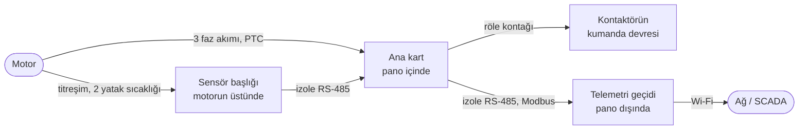
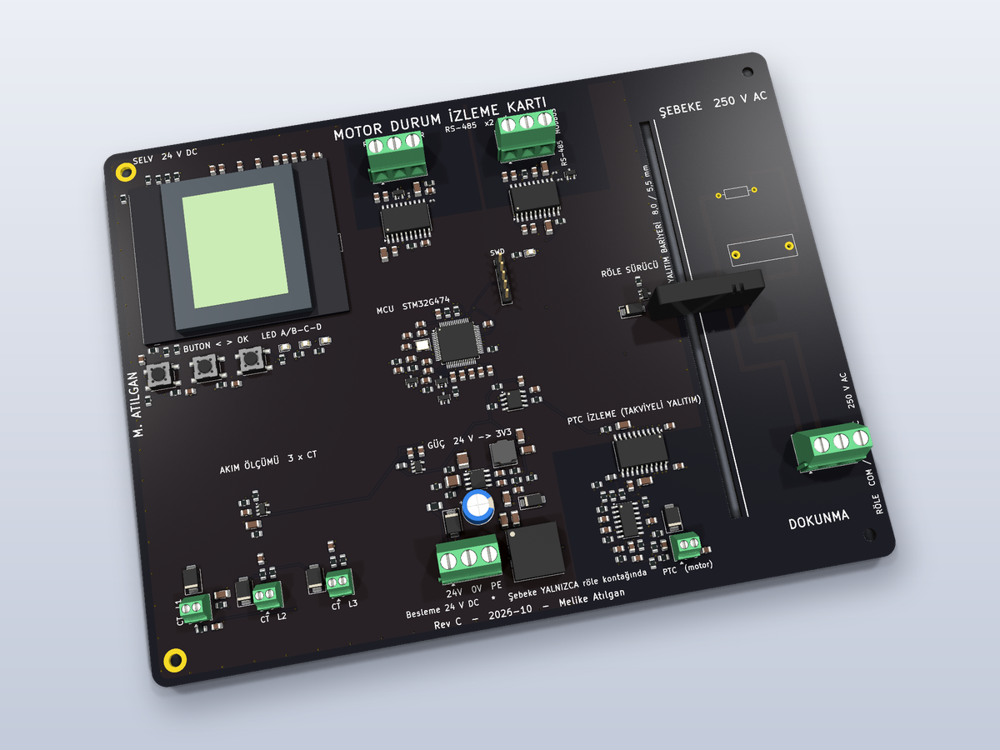
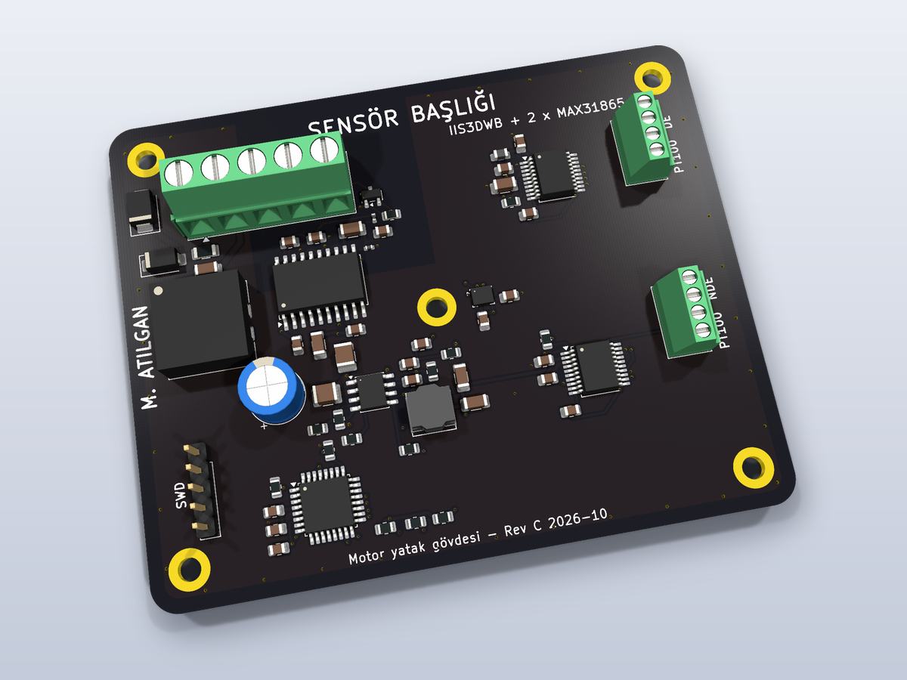
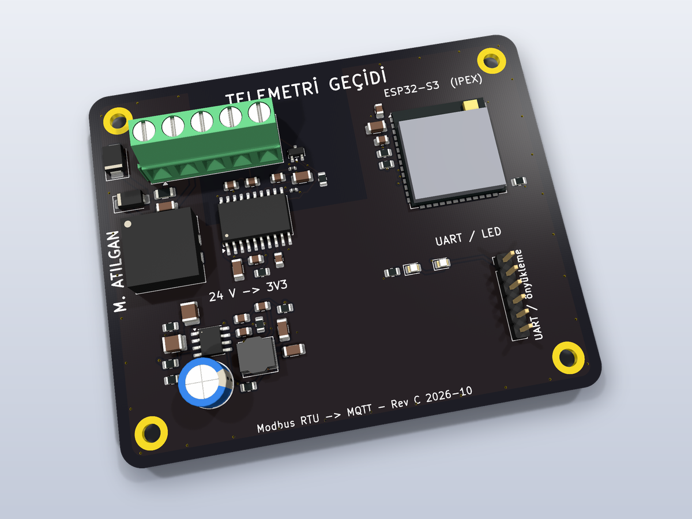
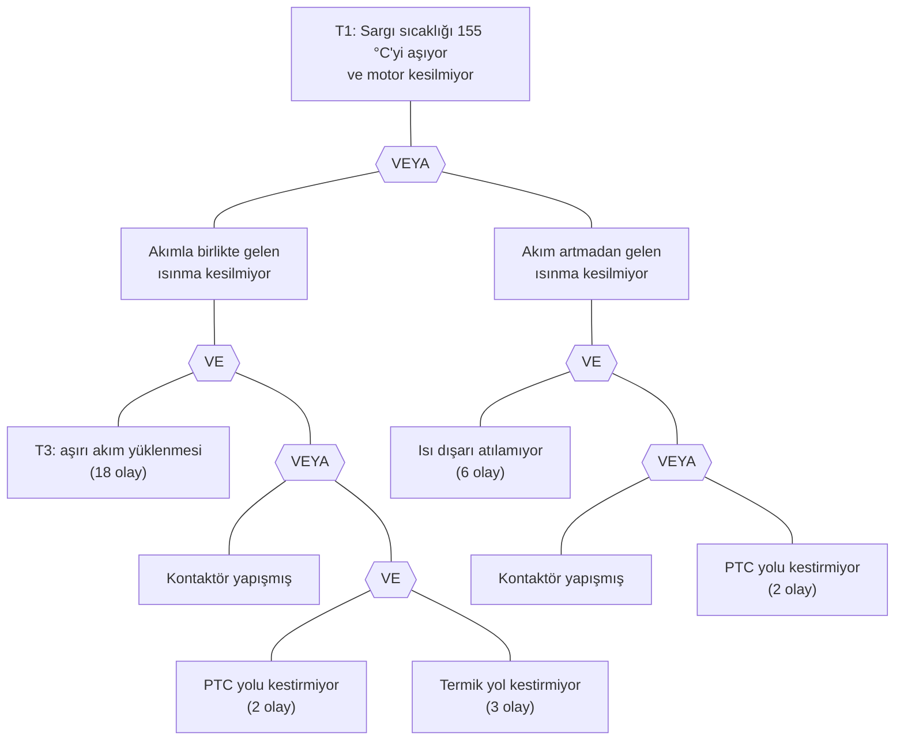
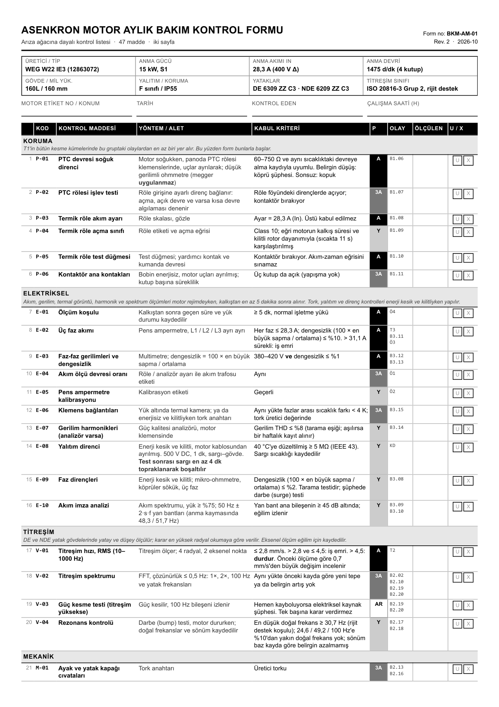
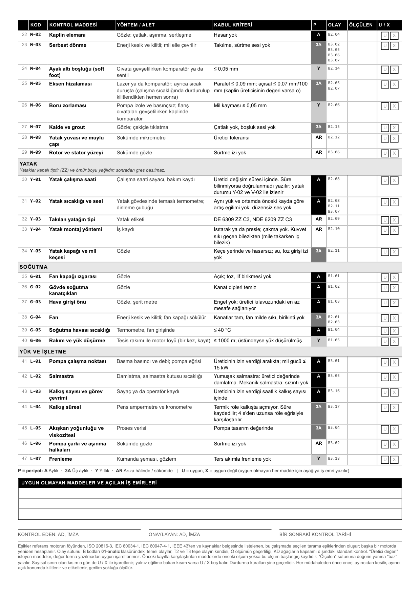
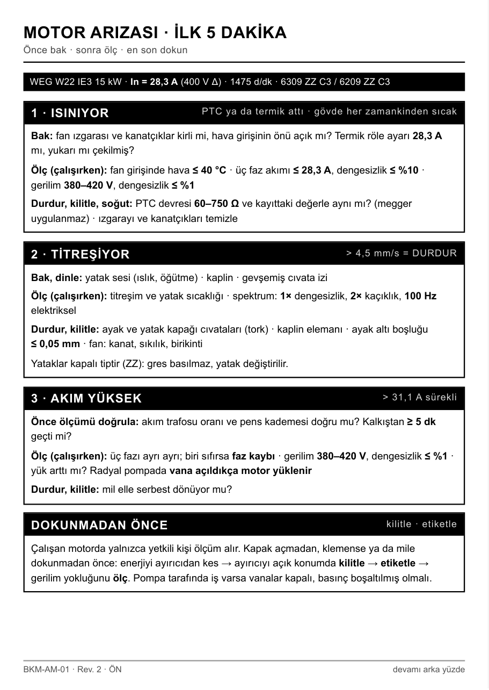
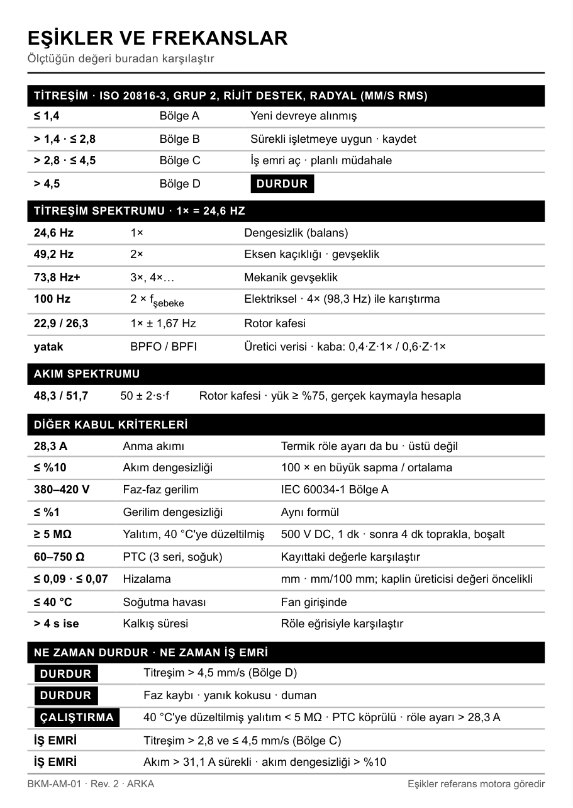

# Asenkron motor: arıza analizi, bakım planı ve izleme kartları

15 kW'lık bir pompa motorunun hangi yollardan arızalanabileceğini arıza
ağaçlarıyla çıkardım. Buna göre aylık bakım formunu ve arıza anında kullanılacak
bir cep kartını hazırladım. Analiz, titreşimin ve yatak sıcaklığının iki aylık
kontrol arasında hiç izlenmediğini gösterdi. Bu boşluğu kapatmak için KiCad'de
üç kart tasarladım.

<p align="center">
  
</p>

## Proje kısaca

**1. Arıza analizi** ([01-analiz/](01-analiz/)). Motorda ters gidebilecek üç
şeyi ele aldım: aşırı ısınma, aşırı titreşim, aşırı akım. Her birini kök
nedenlerine kadar bir arıza ağacıyla açtım. Python betiği hangi nedenlerin
birlikte arızaya yol açtığını hesaplıyor; aşağıdaki 144 / 21 / 18 sayıları
oradan geliyor. Analizin vardığı sonuç: titreşimi ve yatak sıcaklığını izleyen
otomatik bir koruma yok, bu arızalar ancak ayda bir yapılan kontrolde fark
ediliyor.

**2. Saha dokümanları** ([02-saha-dokumanlari/](02-saha-dokumanlari/)).

- **Aylık bakım formu** (A4, 2 sayfa): teknisyenin her ay doldurduğu 47
  maddelik kontrol listesi. Her madde arıza ağacındaki bir nedene bağlı.
- **Saha kartı** (A6 cep kartı): motor arıza verdiğinde ilk 5 dakikada ne
  yapılacağını anlatıyor. Ön yüzde "ısınıyor / titriyor / akım yüksek"
  adımları ve güvenlik kilitlemesi, arka yüzde bakılacak sınır değerlerin
  tablosu var.

**3. İzleme kartları** ([03-donanim/](03-donanim/)). Aylık kontrolün göremediği
aradaki zamanı bunlar kapatıyor:

- **Sensör başlığı:** motorun gövdesine vidalanıyor. Titreşimi ve iki yatağın
  sıcaklığını (PT100) sürekli ölçüyor, kabloyla ana karta gönderiyor.
- **Ana kart:** elektrik panosunun içinde duruyor. Üç faz akımını ve motor
  sargısındaki PTC sıcaklık sensörünü okuyor, ekran ve LED'lerle durumu
  gösteriyor. Sınır aşılırsa röle kontağını açıp motoru durduruyor. Asıl koruma
  değil; termik rölenin yanında ikinci bir güvenlik katmanı.
- **Telemetri geçidi:** pano dışında, Wi-Fi'li (ESP32). Ölçümleri ana karttan
  okuyup ağa (bilgisayar, telefon) aktarıyor. Yalnızca okuyor; üzerinde motoru
  durduracak bir çıkış yok.

Referans motor: WEG W22 IE3, 15 kW, 4 kutup, 400 V Δ, 160L gövde (ürün kodu
12863072). Değerler üreticinin veri föyünden alındı.

## İzleme kartları



<table>
  <tr>
    <td width="33%" align="center" valign="top">
      <a href="03-donanim/README.md#ana-kart"></a>
      <br><b>Ana kart</b><br>
      Pano içinde. Faz akımlarını ve PTC'yi ölçer, LCD'de gösterir, sınır aşılırsa motoru durdurur.
      <br>STM32G474 · 190 × 145 mm
    </td>
    <td width="33%" align="center" valign="top">
      <a href="03-donanim/README.md#sensor-basligi"></a>
      <br><b>Sensör başlığı</b><br>
      Motorun yatak gövdesine vidalanır. Titreşimi ve iki yatağın sıcaklığını ölçer.
      <br>STM32G071 · 90 × 72 mm
    </td>
    <td width="33%" align="center" valign="top">
      <a href="03-donanim/README.md#telemetri-gecidi"></a>
      <br><b>Telemetri geçidi</b><br>
      Pano dışında. Ölçümleri ana karttan okuyup Wi-Fi ile ağa verir.
      <br>ESP32-S3 · 85 × 70 mm
    </td>
  </tr>
</table>

- **Şebeke gerilimi yalnızca röle kontağında.** O bölge kartın geri kalanından
  frezelenmiş bir yarıkla ayrıldı: 8 mm yüzeysel kaçak, 5,5 mm hava aralığı.
- **PTC girişi takviyeli izole** (ISOW7744). Devre kısa devre, normal, attı ve
  kopuk durumlarını ayırıyor; eşikleri en kötü durum hesabıyla seçtim.
- **Kartlar arası bağlantı izole RS-485.** Motor gövdesiyle pano arasındaki
  toprak farkı ölçüme karışmıyor.
- Üç kart da 4 katman. KiCad ERC ve DRC (şema-kart eşleşmesi dahil) 0.

Her kartın ayrıntısı, şeması ve üretim dosyaları: [03-donanim/](03-donanim/).
Kartlar ana koruma değil; sertifikalı termik röle ve PTC rölesine seri giren bir
erken uyarı katmanı.

## Arıza analizi

1. Üç tepe olay ölçülebilir biçimde tanımlandı: sargı sıcaklığının 155 °C'yi
   aşıp motorun kesilmemesi, yatak gövdesinde titreşimin 4,5 mm/s'yi aşması,
   rejimde akımın anma değerinin %110'unu geçmesi, kalkış akımının izin
   verilenden sık ya da uzun çekilmesi ya da ters akımla frenleme.
2. Her tepe olay VE / VEYA kapılarıyla temel olaylara kadar açıldı. Ağaçlar
   birbirine transferle bağlandı.
3. Minimal kesme kümeleri hesaplandı. Sayılar elle sayılmadı; ağaçlar bir
   betikte tanımlı ve kümeler oradan çıkıyor.
4. Her temel olay için bir kontrol, bir kabul kriteri ve bir periyot yazıldı.
   Betik, form üretecindeki olay kodlarını ağaç tanımlarıyla karşılaştırıyor:
   kontrolü olmayan olay ya da tanımsız kod kalırsa hata veriyor. Kontrolün o
   arızayı gerçekten yakalayıp yakalamadığını denetlemiyor.

| Tepe olay | Minimal kesme kümesi | Tek elemanlı | İki elemanlı | Üç elemanlı |
|---|---|---|---|---|
| T1 Sargı aşırı sıcaklığı kesilmiyor | 144 | 0 | 36 | 108 |
| T2 Titreşim Bölge D | 21 | 20 | 1 | 0 |
| T3 Aşırı akım yüklenmesi | 18 | 18 | 0 | 0 |

T1'in yapısı kısaca şöyle:



Buradan üç şey çıkıyor:

- Bu modelde T1'e tek başına giden olay yok. En kısa yollar iki elemanlı:
  herhangi bir ısınma sebebiyle birlikte yapışmış bir kontaktör, ya da bir
  soğutma arızasıyla birlikte çalışmayan PTC yolu.
- Fan ızgarası tıkandığında motorun yükü değişmez, akımı termik röleyi
  açtıracak kadar artmaz. Bu durumda sıcaklığı izleyen tek koruma PTC'dir. PTC
  yolu çalışmıyorsa motoru zamanında kesecek bir şey kalmaz. Form bu yüzden
  PTC, termik röle ve kontaktör kontrolleriyle başlıyor.
- Senaryoda titreşim ve yatak sıcaklığı için otomatik bir izleme yok. İkisi de
  ancak aylık ölçümle fark ediliyor; iki ölçüm arasında gelişen bir yatak
  arızası görülmüyor. İzleme kartları bunun için.

Ayrıntı [kesme-kumeleri.md](01-analiz/kesme-kumeleri.md) içinde.

## Saha dokümanları

Analizden çıkan kontroller iki belgeye dönüştü. İkisi de HTML olarak yazıldı;
yazdırılmış hâlleri PDF:
[aylik-bakim-formu.pdf](02-saha-dokumanlari/aylik-form/aylik-bakim-formu.pdf),
[saha-karti.pdf](02-saha-dokumanlari/saha-karti/saha-karti.pdf).

<table>
  <tr>
    <td width="50%" align="center" valign="top">
      
      <br><b>Aylık bakım formu, 1. sayfa</b><br>
      Teknisyenin her ay doldurduğu kontrol listesi: koruma, elektriksel ve titreşim
      maddeleri. Her satırda kabul kriteri, periyot ve maddenin arıza ağacında hangi
      olayı aradığı yazıyor; teknisyen ölçtüğü değeri ve U (uygun) / X işaretini girer.
    </td>
    <td width="50%" align="center" valign="top">
      
      <br><b>Aylık bakım formu, 2. sayfa</b><br>
      Mekanik, yatak, soğutma ve yük maddeleri. Altta uygun olmayan maddeler için
      açılan iş emirlerinin ve imzaların yazıldığı alan var.
    </td>
  </tr>
  <tr>
    <td width="50%" align="center" valign="top">
      
      <br><b>Saha kartı, ön yüz</b><br>
      A6 cep kartı. Motor arıza verdiğinde ilk 5 dakikada ne yapılacağı: ısınıyor,
      titriyor ya da akımı yüksekse sırayla neye bakılır, motora dokunmadan önce
      enerji nasıl kesilip kilitlenir.
    </td>
    <td width="50%" align="center" valign="top">
      
      <br><b>Saha kartı, arka yüz</b><br>
      Ölçülen değerin karşılaştırılacağı sınırlar: titreşim bölgeleri, spektrumda
      bakılacak frekanslar, motorun ne zaman durdurulacağı, ne zaman iş emri açılacağı.
    </td>
  </tr>
</table>

## Depoda ne var

| Dosya | İçerik |
|---|---|
| [01-analiz/referans-motor.md](01-analiz/referans-motor.md) | Föy değerleri, türetilen değerler, varsayılan işletme senaryosu |
| [01-analiz/T1-asiri-isinma.md](01-analiz/T1-asiri-isinma.md) | T1: sargı aşırı sıcaklığı |
| [01-analiz/T2-titresim.md](01-analiz/T2-titresim.md) | T2: aşırı titreşim |
| [01-analiz/T3-asiri-akim.md](01-analiz/T3-asiri-akim.md) | T3: aşırı akım yüklenmesi |
| [01-analiz/kesme-kumeleri.md](01-analiz/kesme-kumeleri.md) | Minimal kesme kümeleri ve yorumu |
| [01-analiz/kesme_kumeleri.py](01-analiz/kesme_kumeleri.py) | Kümeleri hesaplayan ve formdaki olay kodlarını ağaçlarla karşılaştıran betik |
| [01-analiz/kaynaklar.md](01-analiz/kaynaklar.md) | Kullanılan standartlar, standart dışı değerler, doğrulanmayanlar |
| [02-saha-dokumanlari/aylik-form/](02-saha-dokumanlari/aylik-form/) | 47 maddelik aylık bakım formu (A4, iki sayfa) ve üreteci |
| [02-saha-dokumanlari/saha-karti/](02-saha-dokumanlari/saha-karti/) | Arıza anında bakılacak A6 cep kartı (ön ve arka yüz) |
| [03-donanim/](03-donanim/) | Üç izleme kartı: KiCad projeleri, üretim dosyaları, 3B görüntüler |

## Sınırlar

- Saha ölçümü yok. Analiz belirli bir tesisteki motor için değil, föy ve
  standart değerleriyle bir motor tipi için yapıldı.
- Analiz nitel. Olayların olasılığı ve sonuçlarının şiddeti hesaplanmadı; küme
  sayıları modelin yapısını gösterir, risk büyüklüğü olarak okunmamalı.
- Kısa devre ve toprak arızası koruması kapsam dışı. Termik rölenin motora
  uygunluğu belirli bir rölenin açma eğrisiyle doğrulanmadı; Class 10 başlangıç
  seçimi olarak geçiyor.
- Standart metinlerinin kendisi elimde değildi. Değerler üretici katalogları ve
  uygulama notlarından alındı; hangilerinin standarttan geldiği, hangilerinin bu
  çalışmada seçilen tarama eşiği olduğu [kaynaklar.md](01-analiz/kaynaklar.md)
  içinde ayrı ayrı yazıyor.
- Başka bir motora uygulanırken eşikler o motorun plaka değerleriyle yeniden
  hesaplanmalı.

## Çalıştırmak için

```
python 01-analiz/kesme_kumeleri.py
```

Kümeleri hesaplar ve form üretecindeki olay kodlarını ağaç tanımlarıyla
karşılaştırır.

```
cd 02-saha-dokumanlari/aylik-form
python form-uret.py
```

`aylik-bakim-formu.html` dosyasını yeniden üretir. İkisi de yalnızca Python
standart kütüphanesini kullanır.
